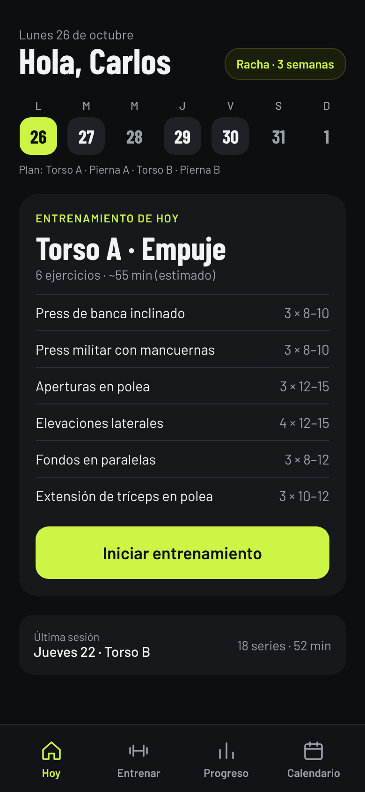
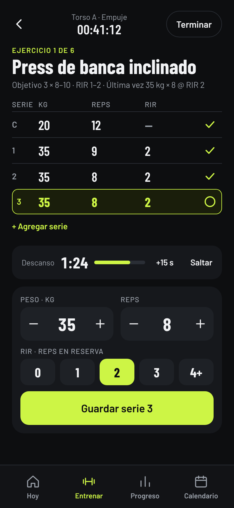
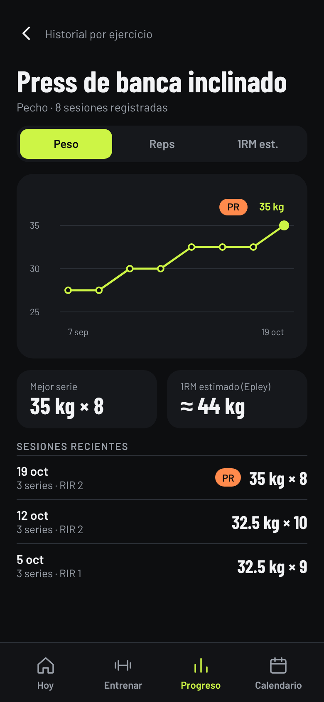
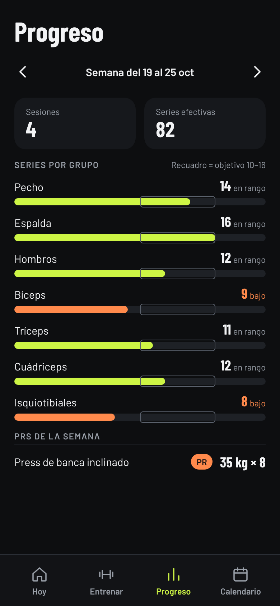
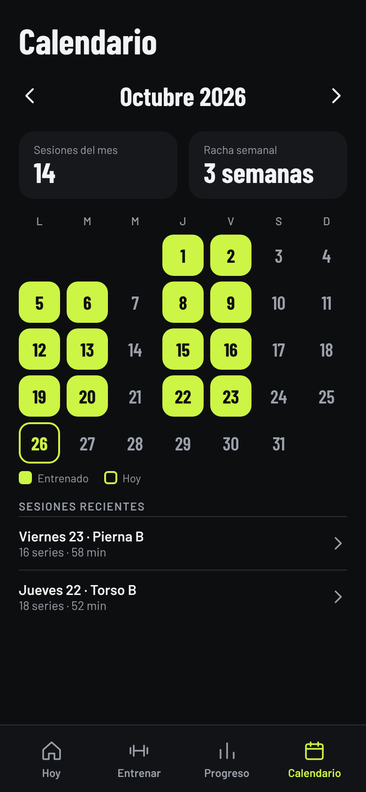

# Gym

App personal para llevar el progreso en el gym: series, peso (en libras), reps, RIR, rutinas y descansos. Next.js (App Router) + Tailwind + Supabase, pensada para desplegarse en Vercel y usarse desde el celular.

## Estado

- Login con correo y contraseña (Supabase Auth), todo protegido por RLS.
- **Hoy**: rutina del día, semana, racha y última sesión.
- **Entrenar**: lista de rutinas y sesión en curso (peso, reps, RIR, calentamiento, PR, temporizador de descanso, referencia de la vez pasada).
- **Historial**: lista de sesiones; cada una se puede editar (peso, reps, RIR, tipo de serie), borrar serie por serie o borrar completa.
- **Sesión**: sugerencia de progresión (estimación) según tu última vez y el rango de la rutina, calculadora de discos y notas por serie y por ejercicio.
- **Mis rutinas**: crea, edita y borra tus rutinas (día, ejercicios nuevos o del catálogo, series, rango de reps y RIR, descanso, orden).
- Instalable como PWA (manifest). Progreso (series efectivas por grupo, PRs, gráfica y 1RM estimado por ejercicio) y Calendario (mes, racha semanal).

## Mockups

Diseño de las pantallas principales (datos de ejemplo). Los HTML estáticos están en [`docs/mockups/`](docs/mockups/) y se abren directo en el navegador.

| Hoy | Sesión en curso | Historial por ejercicio |
| :-: | :-: | :-: |
|  |  |  |

| Progreso semanal | Calendario y racha |
| :-: | :-: |
|  |  |

Historial por ejercicio, Progreso y Calendario ya están implementados.

## Puesta en marcha

1. **Supabase**: crea un proyecto en supabase.com → SQL Editor → pega y ejecuta `supabase/schema.sql`.
2. **Tu usuario**: Authentication → Users → *Add user* (tu correo y contraseña). Como la app es solo para ti, desactiva los registros abiertos en Authentication → Providers → Email → *Allow new users to sign up*.
3. **Variables**: copia `.env.example` a `.env.local` y llena `NEXT_PUBLIC_SUPABASE_URL` y `NEXT_PUBLIC_SUPABASE_ANON_KEY` (Project Settings → API). No subas `.env.local` al repositorio.
4. Local: `npm install` y `npm run dev`. La primera vez, en **Hoy** pulsa *Cargar rutina de ejemplo*.

## Despliegue en Vercel

1. Sube el proyecto a un repositorio de GitHub.
2. En Vercel: *Add New → Project* → importa el repo (Next.js se detecta solo).
3. En *Environment Variables* agrega las mismas variables de `.env.example`.
4. Deploy. Luego, en el celular, abre la URL y "Agregar a pantalla de inicio".

## Estructura

- `src/app/(app)/` pantallas con barra inferior (Hoy, Entrenar, Progreso, Calendario).
- `src/app/actions.ts` acciones de servidor (iniciar sesión de entreno, guardar serie, PR, terminar).
- `src/proxy.ts` refresca la sesión y redirige a `/login`.
- `supabase/schema.sql` tablas, RLS, vista de series por grupo muscular y `seed_defaults()`.

## Modo sin señal

La sesión de entrenamiento funciona sin señal: cada serie se guarda primero en el teléfono (localStorage) y se envía en orden a `/api/sync` en cuanto vuelve la conexión. Cada serie lleva un id generado en el teléfono, así que un reintento no la duplica. No hay service worker: la sesión se abre con señal (al llegar al gym) y de ahí se puede registrar sin red; recargar la página sin señal no funciona.

## Siguiente

Más métricas corporales (v3).
